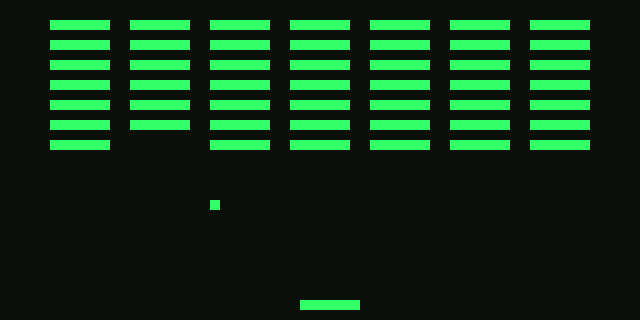
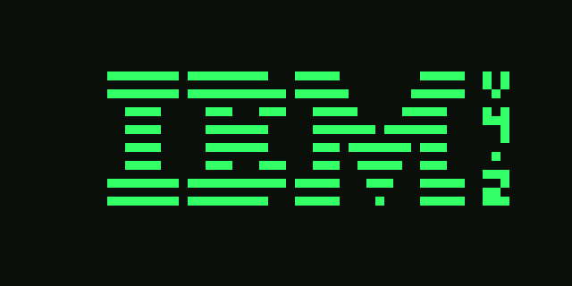
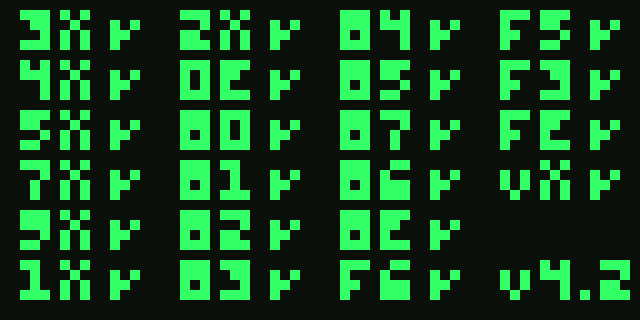

<div align="center">

# CHIP-8 Emülatörü

[English](README.md) | **Türkçe**

C++17 ve SDL2 ile sıfırdan yazılmış bir CHIP-8 emülatörü.<br>
Orijinal 35 komutun tamamını destekler ve [Timendus CHIP-8 test setindeki](https://github.com/Timendus/chip8-test-suite) opcode ve bayrak testlerinden geçer.



</div>

## Hakkında

CHIP-8, 1970'lerde COSMAC VIP gibi ilk mikrobilgisayarlar için oyun yazmayı kolaylaştırmak amacıyla tasarlanmış basit bir sanal makinedir. Hiçbir zaman gerçek bir donanım olarak var olmadı, yalnızca kuralları vardı. Bu proje o makineyi yazılımla yeniden inşa ediyor; böylece 40 yılı aşkın süre önce yazılmış programlar ve oyunlar modern bir bilgisayarda çalışabiliyor.

Emülatör ROM dosyasını belleğe yükler ve gerçek işlemcilerin kullandığı **fetch → decode → execute** (getir → çöz → çalıştır) döngüsüyle komutları tek tek çalıştırır.

## Neden Yaptım

Bu projeyi C++ öğrenmek ve bir işlemcinin perde arkasında gerçekte nasıl çalıştığını anlamak için yaptım. Daha önce hiç C++ yazmamıştım.

Proje **yapay zekâ desteğiyle** geliştirildi: mimariyi planlamak, kodu adım adım yazıp açıklamak ve derleme sorunlarını çözmek için bir yapay zekâ asistanı kullandım. Bu süreçte bellek, register'lar, stack ve fetch → decode → execute döngüsünün nasıl çalıştığını, ayrıca CMake ve SDL2 ile bir C++ projesinin nasıl kurulduğunu öğrendim.

## Ekran Görüntüleri

| IBM logosu | Opcode testi (Timendus seti) |
| :---: | :---: |
|  |  |

## Kontroller

CHIP-8'in 16 tuşlu klavyesi, bilgisayar klavyesinin sol tarafına eşlenmiştir:

```
CHIP-8 klavyesi      Bilgisayar klavyesi
 1 2 3 C              1 2 3 4
 4 5 6 D              Q W E R
 7 8 9 E              A S D F
 A 0 B F              Z X C V
```

| Tuş | İşlev |
| --- | --- |
| `Esc` | Çıkış |

Her oyun bu tuşların farklı bir kısmını kullanır. En yaygın olanlar `W` `A` `S` `D`, `Q` ve `E`.

## Özellikler

- **CHIP-8'in 35 komutunun tamamı**: atlamalar, alt programlar, aritmetik ve mantık işlemleri, çizim, klavye girdisi, zamanlayıcılar ve bellek işlemleri
- **Test edildi**: Timendus test setiyle doğrulandı (IBM logosu, opcode ve bayrak testleri)
- **Doğru sprite çizimi**: XOR ile çizim ve çarpışma algılama
- **Gecikme ve ses zamanlayıcıları**, saniyede 60 kez güncellenir
- **Dahili yazı tipi**: 0–F arası onaltılık rakamlar için
- **Orijinal COSMAC VIP davranışı**: yorumlayıcılar arasında farklı çalışan komutlar için (aşağıya bakın)
- **Büyütülmüş pencere**, siyah üzerine retro yeşil renklerle
- **Elle bağımlılık kurulumu yok**: CMake, SDL2'yi otomatik olarak indirip derler

### Uygulama Notları

Bazı komutlar CHIP-8 yorumlayıcıları arasında farklı davranır. Bu emülatör orijinal COSMAC VIP'i temel alır:

| Komut | Davranış |
| --- | --- |
| `8XY6` / `8XYE` | `VY`'yi kaydırır ve sonucu `VX`'e yazar |
| `FX55` / `FX65` | Register'ları kaydettikten veya yükledikten sonra `I`'yı artırır |
| `8XY1` / `8XY2` / `8XY3` | `VF`'yi 0'a sıfırlar |
| `DXYN` | Sprite'ları ekran kenarında keser, karşı taraftan çıkarmaz |
| `FX0A` | Bir tuşa basılıp bırakılmasını bekler |

İşlemci saniyede yaklaşık 700 komut çalıştırır (60 Hz'lik her karede 11 komut).

## Derleme

**Gereksinimler**

- C++17 destekli bir derleyici (MSVC, GCC veya Clang)
- CMake 3.16 veya üzeri
- Git (CMake, SDL2'yi indirmek için kullanır)

**Windows (Visual Studio)**

Visual Studio'da *C++ ile masaüstü geliştirme* iş yükünü kur. Ardından aşağıdaki komutları *Developer PowerShell* içinde çalıştır ya da klasörü **CMake Tools** eklentisi kurulu VS Code'da açıp `F7`'ye bas:

```powershell
git clone https://github.com/Enes0102/chip8-emulator.git
cd chip8-emulator
cmake -S . -B build
cmake --build build
```

Program `build\Debug\chip8.exe` konumunda oluşur.

**Linux / macOS**

```bash
git clone https://github.com/Enes0102/chip8-emulator.git
cd chip8-emulator
cmake -S . -B build -DCMAKE_BUILD_TYPE=Release
cmake --build build -j
```

## Kullanım

```bash
chip8 yol/rom.ch8
```

ROM dosyaları bu repoya dahil değildir. Bulabileceğin yerler:

- [Timendus/chip8-test-suite](https://github.com/Timendus/chip8-test-suite): test ROM'ları
- [JohnEarnest/chip8Archive](https://github.com/JohnEarnest/chip8Archive): ücretsiz ve açık modern oyunlar

## Proje Yapısı

```
chip8-emulator/
├── assets/            # README'deki ekran görüntüleri
├── src/
│   ├── chip8.h        # Chip8 sınıfı: bellek, register'lar, stack, zamanlayıcılar ve ekran
│   ├── chip8.cpp      # ROM yükleme ve fetch/decode/execute döngüsü
│   └── main.cpp       # SDL penceresi, çizim, klavye girdisi ve ana döngü
├── CMakeLists.txt     # Derleme ayarları (SDL2'yi indirir)
├── README.md          # İngilizce dokümantasyon
└── README.tr.md       # Türkçe dokümantasyon
```

## Yol Haritası

- [ ] Ses (ses zamanlayıcısı çalışırken bip sesi)
- [ ] Komut satırından hız ve davranış ayarları
- [ ] SUPER-CHIP desteği

## Kullanılan Teknolojiler

- C++17
- SDL2
- CMake

## Lisans

Bu proje [MIT Lisansı](LICENSE) ile lisanslanmıştır.

## Geliştirici

**Enescan Güleryüz** — [@Enes0102](https://github.com/Enes0102)
